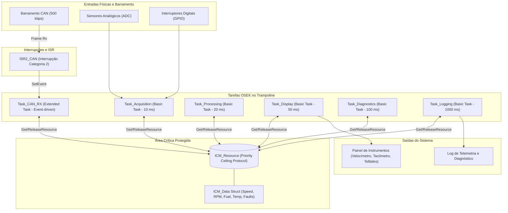

# Arquitetura de Tempo Real - Trampoline RTOS
## Instrument Cluster Module (ICM)
**Disciplina:** Sistemas Embarcados (UTFPR PPGEE)  
**Professor:** Dr. Max Mauro Dias Santos  
**Alunas:** Amanda & Magda  

---

## 1. Visão Geral da Arquitetura OSEK/VDX
O **Trampoline** é um RTOS de código aberto compatível com os padrões **OSEK/VDX** e **AUTOSAR OS 4.2**. O escalonamento é prioritário, estático e preemptivo.



---

## 2. Tabela de Tarefas, Prioridades e Recursos

| Tarefa | Tipo OSEK | Prioridade | Período / Disparo | Eventos | Recursos Usados |
| :--- | :--- | :--- | :--- | :--- | :--- |
| `Task_CAN_RX` | **Extended Task** | **10** (Alta) | Evento CAN (`Event_CAN_RX`) | `Event_CAN_RX` | `ICM_Resource` |
| `Task_Acquisition` | **Basic Task** | **8** | Periódica (**10 ms**) | - | `ICM_Resource` |
| `Task_Processing` | **Basic Task** | **6** | Periódica (**20 ms**) | - | `ICM_Resource` |
| `Task_Display` | **Basic Task** | **4** | Periódica (**50 ms**) | - | `ICM_Resource` |
| `Task_Diagnostics` | **Basic Task** | **3** | Periódica (**100 ms**) | - | `ICM_Resource` |
| `Task_Logging` | **Basic Task** | **1** (Baixa) | Periódica (**1.000 ms**) | - | `ICM_Resource` |

> **Nota sobre o Priority Ceiling:**  
> O teto de prioridade do recurso `ICM_Resource` é igual à maior prioridade entre as tarefas que o acessam (neste caso, prioridade **10**). Quando qualquer tarefa executa `GetResource(ICM_Resource)`, sua prioridade é temporariamente elevada para 10, impedindo preempções indesejadas e prevenindo tanto inversão de prioridade ilimitada quanto *deadlocks*.

---

## 3. Máquina de Estados das Tarefas
* **Suspensa (Suspended):** Tarefa inativa, aguardando ativação por alarme ou interrupção.
* **Pronta (Ready):** Pronta para executar, aguardando o escalonador alocar a CPU.
* **Executando (Running):** Em execução no processador.
* **Aguardando (Waiting):** Exclusivo de Extended Tasks (`Task_CAN_RX`), aguardando o evento `Event_CAN_RX`.

As transições permitidas pelo OSEK e usadas aqui são: `SUSPENDED → READY` (alarme ou `ActivateTask`),
`READY → RUNNING` (escalonador), `RUNNING → READY` (preempção por tarefa de prioridade maior),
`RUNNING → SUSPENDED` (`TerminateTask`), e só na `Task_CAN_RX`: `RUNNING → WAITING` (`WaitEvent`) e
`WAITING → READY` (`SetEvent` feito pela `ISR2_CAN`). O teste `Scheduler.TaskStateSequenceSuspendedReadyRunning`
confere no trace que nenhuma outra transição acontece.

---

## 4. Caminho de um frame CAN

```
ECM/TCM ──frame──► controlador CAN ──IRQ──► ISR2_CAN ──SetEvent──► Task_CAN_RX ──► ICM_Data
                                            (copia pra FIFO)       (valida e decodifica)
Task_Acquisition (10 ms) ─ sensores em volts ─┐
Task_Processing  (20 ms) ─ escala + filtro ───┤ GetResource / ReleaseResource(ICM_Resource)
Task_Diagnostics (100 ms) ─ timeouts, DTCs ───┤
Task_Display     (50 ms) ─ cópia → quadro ────┘──► painel (ponteiros, luzes, mensagem)
```

Receive → Validate → Scale → Filter → Display:
1. **Receive:** `ISR2_CAN` esvazia o FIFO do controlador para um FIFO de 16 posições e chama `SetEvent`.
2. **Validate:** `Task_CAN_RX` rejeita rpm > 8500 e velocidade > 260 km/h (RS-05): mantém o último valor e liga U0401.
3. **Scale:** rpm = bruto × 0,25; velocidade = bruto × 0,05; sensores: volts → % e °C.
4. **Filter:** `Task_Processing` aplica o passa-baixas; `Task_Display` limita o passo dos ponteiros.
5. **Display:** `Task_Display` faz `ICM_GetDataCopy` (com o recurso) e monta o `ICM_DisplayFrame_t`.

Se o frame parar de chegar, a `Task_Diagnostics` acusa o timeout (U0100/U0101) e o painel recebe o valor seguro 0
com a mensagem "FALHA CAN".

---

## 5. Duas configurações OIL

| Arquivo | Alvo | Tick do SystemCounter | Origem da interrupção CAN |
| :--- | :--- | :--- | :--- |
| `oil/icm.oil` | placa (ARM) | 1 ms | controlador CAN |
| `oil/icm_posix.oil` | Trampoline posix (Linux/Mac) | 10 ms (ViPER) | sinal `SIGPIPE` gerado pela `Task_VehicleSim` |

No posix os alarmes estão em ticks de 10 ms (1, 2, 5, 10 e 100 ticks). A `Task_VehicleSim` (prioridade 15) faz o
papel do resto do carro: anda a simulação e manda o sinal quando sai um frame. O GitHub Actions (`.github/workflows/ci.yml`)
baixa o Trampoline, roda `goil --target=posix/linux`, compila com `make.py` e executa 12 s.

---

## 6. Execução sem placa (SIL) e análise de escalonabilidade

O mesmo `src/tasks.c` roda num núcleo OSEK simulado (`sim/osek_sil.c`), gerado a partir do `oil/icm.oil` pelo
`tools/oil2sil.py` (o `ctest` confere que o OIL e a configuração do SIL estão iguais). Cada tarefa tem um tempo de CPU
estimado em `sim/wcet.csv`; o núcleo simula a CPU em microssegundos, com preempção por prioridade e o teto do recurso.

| Tarefa | C (µs) | seção crítica (µs) | T (ms) | R analítico (µs) | R medido máx. (µs) |
| :--- | ---: | ---: | ---: | ---: | ---: |
| ISR2_CAN | 25 | 0 | evento | 25 | 25 |
| Task_CAN_RX | 90 | 30 | evento | 275 | 115 |
| Task_Acquisition | 180 | 40 | 10 | 455 | 295 |
| Task_Processing | 140 | 90 | 20 | 595 | 435 |
| Task_Display | 1200 | 60 | 50 | 1795 | 1635 |
| Task_Diagnostics | 220 | 160 | 100 | 1915 | 1855 |
| Task_Logging | 450 | 60 | 1000 | 2305 | 2305 |

R = C + B + Σ⌈R/Tj⌉·Cj (B = maior seção crítica de tarefa de prioridade menor). Utilização total 5,19 %, abaixo do
limite de Liu & Layland; todas as respostas ficam muito dentro do prazo. A linha do tempo gerada está em
`docs/evidencias/linha_do_tempo_1s.svg` e o zoom no instante 1000 ms (quando todas as tarefas são liberadas juntas)
em `docs/evidencias/linha_do_tempo_zoom.svg`.


