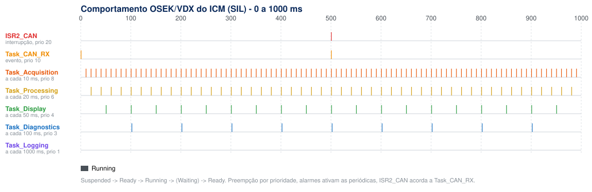
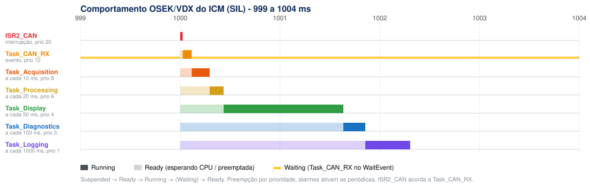

# Relatório de temporização e falhas - ICM (SIL)

Gerado por `build/icm_sil --report docs/evidencias` (sim/icm_sil_run.c). O firmware é o mesmo `src/tasks.c` do Trampoline, rodando no núcleo OSEK simulado (`sim/osek_sil.c`), com a configuração tirada do `oil/icm.oil` por `tools/oil2sil.py` e o tempo de CPU de `sim/wcet.csv`.

- Duração simulada: **30 s**, SystemCounter de 1 ms, custos x1.0
- Roteiro de falhas: demonstração (`VSim_DemoScenario` em src/vehicle_sim.c)
- Hash do trace (FNV-1a): `cf078ceb7e9a8f90` - rodar de novo dá o mesmo valor (determinismo)

## 1. Verificações do Projeto 2

| Verificação | Resultado | Detalhe |
| :--- | :---: | :--- |
| Functional Correctness | OK | 9 de 9 reações de falha corretas; 53 frames M1 e 26 M2 decodificados |
| Task Periods | OK | 10/20/50/100/1000 ms exatos em todas as ativações |
| Deadline Compliance | OK | 0 prazos perdidos, 0 ativações perdidas (E_OS_LIMIT) |
| Data Freshness | OK | idade máx. no painel: M1 450 ms (período 500), M2 950 ms (período 1000) |
| CAN Timeout Handling | OK | U0100 após >1000 ms sem M1, U0101 após >2000 ms sem M2, valor seguro 0; latência ISR->decodificado 115 us (RTR-01 < 2 ms) |
| Resource Protection | OK | teto 10; 0 violações de teto, 0 erros de API, no máx. 1 tarefa dentro do ICM_Resource |
| Deterministic Dashboard Update | OK | 599 quadros, intervalo 50..50 ms; hash do trace cf078ceb7e9a8f90 |
| Schedulability (RTA) | OK | utilização 5.19 %; pior resposta analítica dentro do prazo em todas |
| Trace and Test Report | OK | este arquivo, `jobs.csv`, `trace_estados.csv`, `linha_do_tempo_*.svg` e o relatório dos testes |

## 2. Análise de escalonabilidade (RTA)

Prioridade fixa e preemptiva (OSEK `SCHEDULE = FULL`). Tempo de resposta no pior caso:

Ri = Ci + Bi + Σj ∈ hp(i) ⌈Ri / Tj⌉ · Cj

onde Bi é o maior trecho dentro do `ICM_Resource` de uma tarefa de prioridade menor (com o teto de prioridade do OSEK, cada tarefa espera no máximo um trecho desses). A ISR e a Task_CAN_RX entram com o intervalo mínimo entre frames (500 ms).

| Tarefa / ISR | Prio | T (ms) | C (µs) | Recurso (µs) | U | B (µs) | R analítico (µs) | Prazo (ms) | R medido máx (µs) | R médio (µs) | Ativações | Período medido (µs) | Perdas | Preempções |
| :--- | :---: | ---: | ---: | ---: | ---: | ---: | ---: | ---: | ---: | ---: | ---: | :---: | ---: | ---: |
| `ISR2_CAN` | 20 | 500* | 25 | 0 | 0.0001 | 0 | 25 | 1 | 25 | 25 | 53 | 500000 .. 3500000 (evento) | 0 | 0 |
| `Task_CAN_RX` | 10 | 500* | 90 | 30 | 0.0002 | 160 | 275 | 2 | 115 | 115 | 54 | 500000 .. 3500000 (evento) | 0 | 0 |
| `Task_Acquisition` | 8 | 10 | 180 | 40 | 0.0180 | 160 | 455 | 10 | 295 | 182 | 2999 | 10000 .. 10000 | 0 | 0 |
| `Task_Processing` | 6 | 20 | 140 | 90 | 0.0070 | 160 | 595 | 20 | 435 | 324 | 1499 | 20000 .. 20000 | 0 | 0 |
| `Task_Display` | 4 | 50 | 1200 | 60 | 0.0240 | 160 | 1795 | 50 | 1635 | 1460 | 599 | 50000 .. 50000 | 0 | 0 |
| `Task_Diagnostics` | 3 | 100 | 220 | 160 | 0.0022 | 60 | 1915 | 100 | 1855 | 1760 | 299 | 100000 .. 100000 | 0 | 0 |
| `Task_Logging` | 1 | 1000 | 450 | 60 | 0.0004 | 0 | 2305 | 1000 | 2305 | 2293 | 29 | 1000000 .. 1000000 | 0 | 0 |

\* intervalo mínimo entre frames CAN (M1 a cada 500 ms).

- Utilização total U = **5.19 %** (limite de Liu & Layland pra 7 tarefas: 72.9 %)
- CPU ocupada medida na simulação: **5.18 %**
- Latência máxima frame CAN -> decodificado (ISR2_CAN + Task_CAN_RX): **115 µs** (RTR-01: < 2 ms)
- Frames: M1 enviados 59 / decodificados 53, M2 enviados 29 / decodificados 26, rejeitados por faixa 3 (a diferença enviados x decodificados é o tempo com barramento mudo)

## 3. Falhas injetadas e reação do painel

| t (ms) | Falha | Reação esperada | Detectada após (ms) | Limite (ms) | OK |
| ---: | :--- | :--- | ---: | ---: | :---: |
| 6000 | barramento CAN mudo | U0100 + MIL + rpm 0 (RS-01) | 550 | 1600 | sim |
| 6000 | barramento CAN mudo | U0101 + MIL + velocidade 0 (RS-02) | 1050 | 3100 | sim |
| 10000 | ECM manda 9999 rpm | descarta, U0401 + MIL (RS-05) | 50 | 600 | sim |
| 12000 | sensor de temperatura solto | P0115 + MIL | 50 | 100 | sim |
| 14000 | sensor de combustível solto | P0460 + MIL | 50 | 100 | sim |
| 16000 | ventoinha queimou | luz TEMP em >= 115 °C (RS-03) | 2650 | 4000 | sim |
| 22000 | cinto solto | luz do cinto (RF-08) | 50 | 100 | sim |
| 26000 | motor desligado | luzes de óleo e bateria (RF-08) | 50 | 600 | sim |
| 26000 | freio de mão puxado | luz do freio (RF-08) | 50 | 1100 | sim |

O limite já inclui o tempo do próprio requisito (ex.: 1000 ms sem M1) mais o período de quem detecta (Task_Diagnostics, 100 ms) e o da amostra (50 ms).

## 4. Linha do tempo

Zoom em t = 999..1004 ms (todas as tarefas vencem juntas no t = 1000 ms, com M1 e M2 chegando):

